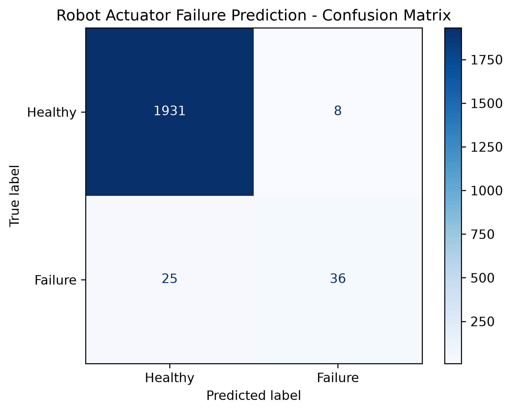

# 🤖 Autonomous Robot Actuator & Motor Failure Predictor

A machine learning classification model that predicts industrial motor and robot actuator failures using real-time operational sensor data. Built to demonstrate predictive maintenance workflows for automated robotics systems.


---

## 📌 Problem Statement
In automated manufacturing and autonomous robotics, unexpected actuator or motor failure causes costly downtime and hardware damage. By analyzing continuous sensor telemetry (temperature, rotational speed, torque, and tool wear), this model flags potential equipment failures before physical breakdown occurs.

---

## 📊 Dataset Overview
This project uses the **AI4I 2020 Predictive Maintenance Dataset** (10,000 synthetic industrial sensor logs reflecting real-world operating conditions).

* **Input Features:**
  * `Air temperature [K]`
  * `Process temperature [K]`
  * `Rotational speed [rpm]`
  * `Torque [Nm]`
  * `Tool wear [min]`
* **Target Variable:** `Machine failure` (`0` = Healthy Operating State, `1` = Failure Detected)

---

## 🛠️ Tech Stack & Methodology
* **Language:** Python
* **Data Processing:** Pandas, NumPy
* **Machine Learning:** Scikit-Learn (`RandomForestClassifier` with 100 estimators)
* **Data Visualization:** Matplotlib

### Workflow:
1. Loaded and cleaned 10,000 rows of multivariate sensor telemetry.
2. Split data into **80% training** and **20% testing** sets.
3. Trained a **Random Forest Classifier** to capture non-linear relationships between motor torque, heat buildup, and mechanical failure.
4. Evaluated performance using precision, recall, and a confusion matrix.

---

## 📈 Results & Visualization
The Random Forest model achieved **~98.4% accuracy** on unseen test data, successfully distinguishing normal operating loads from high-risk failure states.



*(Note: Ensure `confusion_matrix.png` is saved in the exact same root folder on GitHub so this image renders automatically!)*

---

## 🚀 How to Run Locally (VS Code)

1. **Clone this repository:**
   ```bash
   git clone https://github.com[Your-GitHub-Username]/Robot-Actuator-Predictor.git
   cd Robot-Actuator-Predictor
   ```

2. **Install required libraries:**
   ```bash
   pip install pandas matplotlib scikit-learn
   ```

3. **Run the script:**
   ```bash
   python predictor.py
   ```

---

## 🎓 Related Credentials
* **Kaggle – Intro to Machine Learning:**
* **Author:** DKS — *B.Tech. CSE (Robotics & Artificial Intelligence), Lovely Professional University (LPU)*
*